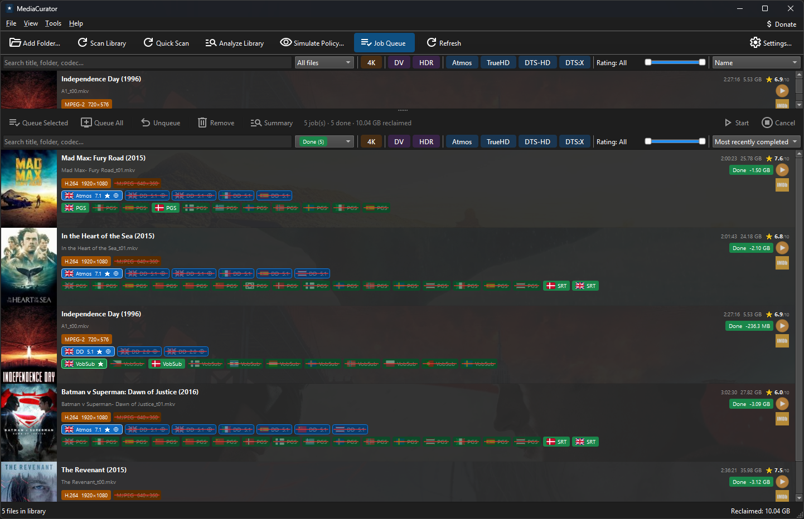
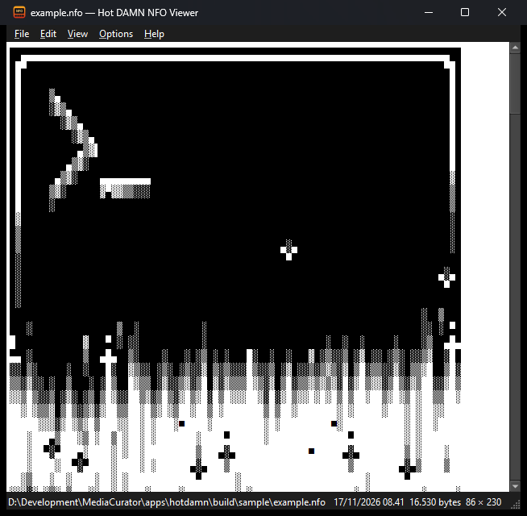

# MediaCurator

[](https://github.com/bleze/MediaCurator/releases/latest)
[](https://github.com/bleze/MediaCurator/actions/workflows/build.yml)
[](LICENSE)

**MediaCurator** is a desktop application that helps you reclaim hard drive space by stripping unwanted audio tracks and subtitle streams from your video library — without re-encoding the video. Windows is the primary platform; macOS and Linux builds are available too.

**[Download the latest release](https://github.com/bleze/MediaCurator/releases/latest)** · [Installation guide](docs/INSTALL.md) · [Full feature reference](docs/FEATURES.md)

> Just want to read `.nfo` files? MediaCurator's NFO viewer is also available on its own as **[Hot DAMN NFO Viewer](#hot-damn-nfo-viewer)**.

## What It Does

Modern movie files often ship with 8–15 audio tracks covering every language used in distribution, plus multiple subtitle streams, commentary tracks, and secondary mixes. If you only watch films in one or two languages, all of those extra streams are dead weight. A typical Blu-ray rip can carry 2–3 GB of audio tracks you will never use.

MediaCurator scans your library, identifies which tracks you actually want, and queues up lossless remux operations (via **mkvmerge**) to remove the rest. Because the video stream is never touched, there is zero quality loss and no re-encoding — processing is far faster than a transcode, though large files can still take several minutes.

**Practical savings:** removing a 5.1 DTS-HD MA English track plus a Dolby Atmos track from a 4K Blu-ray rip can save 2–4 GB per file. For a library of 200 films that is 400–800 GB — at upwards of $300 for a 16 TB NAS drive, that is real money, or simply a proportionally larger library on the hardware you already own.

## Is It Safe?

- **Nothing is touched until you approve it.** Scanning and analysis only read your files; every proposed removal sits in the job queue for review first.
- **Preview before you commit.** The "What If" simulation shows affected files and estimated savings without creating a single job.
- **Lossless.** Tracks are removed by remuxing; video and the audio you keep are copied bit-for-bit.
- **Verified before it replaces anything.** The new file is written to a temporary file and checked against the expected track layout, and its video is checked to run as long as the original's, so an output cut short by a dropped network connection is thrown away; the original is only replaced once both checks pass. If the result doesn't match, you are asked to review it instead.
- **Stops when something is wrong.** If a job fails because the NAS or disk is unavailable, or two jobs fail in a row, the queue pauses and tells you why instead of carrying on.
- **Stale jobs are dropped, not run.** If a file changed on disk since its job was proposed, MediaCurator re-scans it rather than remuxing against outdated information.

Once a job has completed, the removed tracks are gone — keep a backup of anything you can't replace.

## Screenshots

For a small test library of 5 movies, here is what MediaCurator looks like in action:

| Library view | "What If" simulation |
|---|---|
| <br>*Every file scanned with full stream metadata — audio, subtitles, resolution, and HDR format at a glance.* | <br>*Preview affected files and estimated space savings across the whole library before creating a single job.* |

| Job queue | Done jobs — space reclaimed |
|---|---|
| <br>*Proposed track removals queued for review — nothing is touched until you approve.* | <br>*Finished jobs show exactly how much space was reclaimed, file by file.* |

After setting rules to retain only English and Danish audio and subtitle tracks (no commentary), the estimate is that we can reclaim 10 GB of disk space, and the final result is exactly that — **10 GB** of irrelevant or redundant audio tracks and subtitles removed. 9% disk space reclaimed.

## Features

A summary — see the [feature reference](docs/FEATURES.md) for the full detail on each.

### Library & scanning

- **Library scanning** — Catalogues every video file with full stream information (codec, language, channels, resolution, HDR format). Incremental rescans skip unchanged files.
- **Storage groups** — Folders on different drives or NAS volumes scan and remux in parallel; folders sharing a volume are processed one at a time.
- **File card view** — Each file is a card with colour-coded badges for its video, audio, and subtitle streams; tracks proposed for removal are struck through.
- **Filtering & sorting** — Quick-filter pills (4K, Dolby Vision, HDR, Atmos, TrueHD, DTS-HD, DTS:X), text search across filenames and stream metadata, and several sort orders.
- **Group by Movie** — Collapses every edition of a title into one card, with a "duplicates" filter to spot accidental re-downloads.
- **Editions, 3D & categories** — Detects the cut (Director's Cut, Extended, ...), the 3D format, and whether a file is a Movie, TV, Documentary, or Misc.
- **Dolby Vision deep scan** *(opt-in)* — Tells you whether a Dolby Vision file's enhancement layer is FEL or MEL.
- **Ignore files & play** — Hide extras from the library, and play any file in your system's default player.

### Rules & analysis

- **Smart rule engine** — Configurable rules decide which tracks to keep: your languages, the highest-quality track, never the only audio track, always forced subtitles.
- **Quick Analyze** — Runs the rules over only the files that have never been analyzed, so it's fast after a scan turns up a few new ones.
- **"What If" simulation** — Runs the rules across the whole library without creating jobs, and shows the estimated space saved.
- **Any container in, MKV out** — Blu-ray/DVD ISO, MP4, AVI and other formats are supported; the output is always a clean `.mkv`.
- **Cover-art removal** — Embedded cover-art streams can be stripped too.

### Job queue & track editing

- **Job queue** — Review proposed removals, then run them. One job per storage group runs at a time; start, retry, cancel, or remove individual jobs.
- **Manual overrides** — Right-click any track badge to override the rule decision for that file.
- **Stream flag editing** — Toggle Default, Forced, SDH, Commentary, and Original flags straight from the card, applied losslessly via mkvpropedit.

### Subtitles

- **Subtitle download** — Fetch missing subtitle languages from [OpenSubtitles.com](https://www.opensubtitles.com), with timing cross-checked against a subtitle already on the file to catch wrong-release downloads.
- **Sidecar subtitles** — External `.srt`/`.ass`/`.sup` files are detected, shown on the card, and merged into the `.mkv` when a job runs.

### Artwork & metadata

- **Posters & backdrops** — Fetched from TMDB or picked up from local artwork using Kodi/Plex naming conventions.
- **IMDb / TMDB matching** — Automatic identification, with a search dialog to match a movie by hand.
- **NFO writer** *(opt-in)* — Saves IDs, titles, year, and rating to a Kodi/Plex-compatible `.nfo`, enriching an existing one rather than rewriting it.
- **Scene NFO viewer** — Shows a release's original `.nfo` with its ASCII art rendered seamlessly and linked screenshots displayed inline; zoom, font and night colours on right-click. Damaged NFOs show whatever art survived. Also available standalone as [Hot DAMN NFO Viewer](#hot-damn-nfo-viewer).
- **Scene NFO download** *(opt-in)* — Fetches a missing or damaged scene `.nfo` from [srrDB](https://www.srrdb.com/).

### Integrations & extras

- **NZBGet / SABnzbd** *(opt-in)* — Shows the live download queue above the library and can scan and analyze new downloads automatically.
- **Automatic updates** — Checks GitHub for new releases and installs them with one click.
- **Money Saved estimate** — Puts a dollar value on your reclaimed space, based on live average HDD pricing.
- **Leaderboard** *(opt-in)* — Compare total space reclaimed with other users.
- **Dark mode** — Follows the system colour scheme.

## Hot DAMN NFO Viewer

**Hot DAMN NFO Viewer** is MediaCurator's scene NFO viewer as a small standalone Windows app — a nod to the DAMN NFO Viewer of old. Double-click an `.nfo` and it opens.

**[Download Hot DAMN NFO Viewer](https://github.com/bleze/MediaCurator/releases?q=%22Hot+DAMN+NFO+Viewer%22)** — pick the newest `HotDamn-Setup-x.y.z.exe` (Windows 10/11, 64-bit). It is released separately from MediaCurator, so it is not under "Latest release".



- **Art rendered as drawn** — block, shade and line-drawing characters are painted as exact cells rather than font glyphs, so there are no seams between rows or columns, at any zoom. Cells keep the 5:12 shape of DOS text mode.
- **Encoding detection** — CP437, UTF-8 and Latin-1 are told apart automatically, and DOS symbol characters are shown instead of empty boxes.
- **Damaged files recovered** — an NFO that some tool once re-saved in the wrong encoding gets its surviving art back in place; characters that were lost show as grey cells, and the status bar says how many.
- **Black on white, whatever your theme** — the way the art was drawn; night colours are one click away.
- **Links and images** — BBCode and links are rendered, and linked screenshots can be shown inline.
- **Everyday conveniences** — drag and drop, zoom, a choice of fonts, copy on select, always on top, reuse of the open window, and a status bar with the file's date, size and columns × rows.
- **File association** — the installer registers it for `.nfo` and `.diz`; Windows asks you to confirm it as the default.
- **Automatic updates** — checks GitHub for a new version once a day (or on demand under **Help → Check for Updates**) and installs it with one click.

MediaCurator's own NFO dialog uses the same engine (`libs/nfoview`), so both render identically.

Hot DAMN lives in `apps/hotdamn` as its own CMake project with its own version and installer, and needs only Qt — none of MediaCurator's external tools. To build it:

```powershell
cmake -S apps/hotdamn -B apps/hotdamn/build -DQt6_DIR="<path>/Qt/6.8.3/msvc2022_64/lib/cmake/Qt6"
cmake --build apps/hotdamn/build --config Release
cpack --config apps/hotdamn/build/CPackConfig.cmake -C Release   # NSIS installer
```

## Requirements

**The installer bundles all required tools** — no separate downloads needed. See the [installation guide](docs/INSTALL.md) for per-platform steps.

| Tool | Role | License |
|------|------|---------|
| [ffprobe](https://ffmpeg.org/) (FFmpeg) | Stream analysis | LGPL/GPL, depending on build |
| [mkvmerge / mkvpropedit](https://mkvtoolnix.download/) (MKVToolNix) | Lossless remux, flag edits | GPL v2 |
| [dovi_tool](https://github.com/quietvoid/dovi_tool) | Dolby Vision deep scan | MIT |

These are separate programs that MediaCurator runs as external processes; they are not linked into the application and remain under their own licenses.

Optional API keys, both free — the app works without them:

- **TMDB** — enables poster art and movie search. Get a key at [themoviedb.org/settings/api](https://www.themoviedb.org/settings/api) and enter it in **Settings**.
- **OpenSubtitles** — enables subtitle download. Register at [opensubtitles.com](https://www.opensubtitles.com) and enter the key in **Settings → OpenSubtitles**.

### Platform support

| Platform | Status |
|----------|--------|
| Windows 10 / 11 | Primary — fully tested |
| macOS 12+ | Builds and runs; less tested |
| Linux (x64) | Builds and runs; less tested |

## Building from Source

MediaCurator is written in C++20 with Qt 6.8+. There is no external package manager — dependencies are vendored under `third_party/`.

```powershell
# Windows
cmake --preset local-release
cmake --build --preset local-release
```

```bash
# macOS / Linux
cmake --preset release
cmake --build --preset release
```

See [docs/BUILDING.md](docs/BUILDING.md) for detailed environment setup and CMakeUserPresets configuration.

The external tools are not in the repository. Run `scripts/setup_tools.ps1` (Windows) or `scripts/setup_tools.sh` (macOS / Linux) to download them into `tools/`; the build copies that folder next to the executable. See [tools/README.md](tools/README.md) for the expected layout.

## License

MediaCurator itself is licensed under the [Apache License 2.0](LICENSE). The bundled external tools listed under [Requirements](#requirements) keep their own licenses.

## Donate

If MediaCurator saves you money on storage or just makes managing your media library less painful, consider saying thanks or supporting continued development:

| Platform | Link | Fee |
|----------|------|-----|
| PayPal | [paypal.me/blezedk](https://paypal.me/blezedk) | ~3% |
| ⚡ Lightning | `bleze@cake.cash` | ~0% |
